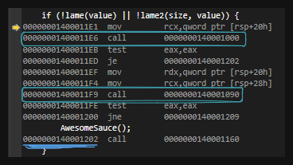

# Challenge Description

**Objective:** Exploit a buffer overflow vulnerability to execute `AwesomeSauce()`.

Under normal execution, `AwesomeSauce()` is called only when `lame()` or `lame2()` returns `0`. Our goal is to bypass this restriction.

## A. Input Analysis

  
  

The program accepts two command-line arguments: `argv[1]` and `argv[2]`. Meanwhile, `argv[0]` contains the executable's name or path.

Both inputs are initially strings and are converted into 64-bit integers using `_strtoi64`:

`size = _strtoi64(argv[1], "", 10);`

`value = _strtoi64(argv[2], "", 16);`

- `argv[1]`: Interpreted in base 10 and stored in `size`.
- `argv[2]`: Interpreted in base 16 and stored in `value`.

**Example:** Input `2 10` → `size = 2`, `value = 16 (0x10)`.

## B. Analyzing lame() and lame2()

We will analyze the Assembly instructions and reconstruct the stack layout using Visual Studio Debugger.

### B.1. lame()

#### 1. Stack initialization

At the beginning of `main()`:

- `RCX` stores `argc` (argument count).
- `RDX` stores `argv` (pointer to the argument array).

Their values are saved at `[15FE40]` and `[15FE48]`, respectively.

The instruction `sub rsp, 38h` allocates stack space:

#### 2. Input storage

  
  

After `_strtoi64` processes both inputs:

- `size` → `[rsp + 28h]`
- `value` → `[rsp + 20h]`

Updated stack layout:

#### 3. Entering lame()

The highlighted instructions correspond to:

- `call lame()`
- `call lame2()`
- The instruction that calls `AwesomeSauce()`

Stepping into `lame()`, the `call` instruction pushes the return address onto the stack at `[15FDF8]`.

Inside `lame()`:

- `RCX` contains `value` and is saved at `[15FE00]`.
- `sub rsp, 0A8h` → `RSP = 15FD50`.

The program initializes `array2[0]` through `array2[3]` with `value`.

| Element | Stack address |
|---|---|
| `array2[0]` | `15FD70` |
| `array2[1]` | `15FD78` |
| `array2[2]` | `15FD80` |
| `array2[3]` | `15FD88` |

#### 4. Analyzing memcpy()

According to the Windows x64 calling convention, the first three arguments of `memcpy` are passed through:

- `RCX`: Destination (`array1`)
- `RDX`: Source (`array2`)
- `R8`: Number of bytes to copy (`40h` = 64 bytes)

The destination begins at:

`array1[0] = [rsp + 60h] = [15FDB0]`

Therefore, the destination range is:

- **Start:** `15FDB0`
- **End (exclusive):** `15FDB0 + 40h = 15FDF0`
- **Last byte:** `15FDEF`

The saved return address is located at `[15FDF8]`, outside the copied range.

**Conclusion:** `lame()` copies exactly 64 bytes into a 64-byte destination buffer. Therefore, this `memcpy` operation does not overflow `array1`, regardless of the supplied input values.

### B.2. lame2()

Back in `main()`:

- `RSP = 15FE00`
- `RCX = [rsp + 28h]` → `size`
- `RDX = [rsp + 20h]` → `value`

Stepping into `lame2()`, the `call` instruction pushes the return address onto the stack:

`15FE00 - 8 = 15FDF8` → `[15FDF8] = RET`

At the beginning of `lame2()`, `RCX` and `RDX` are saved at `[15FDF8 + 8h]` and `[15FDF8 + 10h]`, corresponding to `INPUT1` and `INPUT2`, respectively.

After executing `sub rsp, 88h`:

`RSP = 15FDF8 - 88h = 15FD70`

From the Assembly instructions, we can determine the address of `array2[5]`:

`array2[5] = [15FD70 + 28h + 20h] = [15FDB8] = INPUT2`

Therefore, the elements of `array2` are stored at:

- `[15FDB0] = INPUT2`
- `[15FDA8] = INPUT2`
- `[15FDA0] = INPUT2`
- `[15FD98] = INPUT2`
- `[15FD90] = INPUT2`

**Conclusion:** The starting address of `array2` is `15FD90`.

Here, `RAX` is assigned `INPUT1`, followed by `shl rax, 3`, which shifts `RAX` left by 3 bits (equivalent to multiplying by 8).

For example:

- `INPUT1 = 3` → `RAX = 18h` = 24 bytes.
- `INPUT1 = 7` → `RAX = 38h` = 56 bytes.
- `INPUT1 = 8` → `RAX = 40h` = 64 bytes.

Therefore, we can determine that:

`Number of bytes copied = INPUT1 × 8`

The starting addresses of `array1` and `array2` are:

- `array1 = [15FD70 + 50h] = [15FDC0]` (Destination)
- `array2 = [15FD70 + 20h] = [15FD90]` (Source)

The `memcpy` function copies data from `array2` into `array1`.

Notice the distance between the beginning of `array1` and the saved return address:

`15FDF8 - 15FDC0 = 38h` (56 bytes)

With `INPUT1 = 7`, `memcpy` copies `38h` bytes, ending at address `15FDF7`, just before the saved return address.

Now, let's try `INPUT1 = 8`. The copy size increases to `40h` bytes, extending into the memory location containing the saved return address.

After executing `memcpy`, we can observe that the saved return address has been overwritten with `INPUT2`:

  
  

When the `ret` instruction executes, the CPU attempts to jump to the overwritten return address. If `INPUT2 = 0x4`, the program throws an **Access Violation** because `0x4` is not a valid executable address.

This suggests that we can use `INPUT2` to redirect execution to a valid instruction address.

Since our goal is to execute `AwesomeSauce()`, we need to find the address of the instruction that calls this function.

From the disassembly, we can identify the address of the `call AwesomeSauce()` instruction:

`0000000140001202`

Therefore, we can use this address as `INPUT2` to redirect execution to the desired instruction.

**Final Input:**

`8 0000000140001202`

**Conclusion:** Instead of forcing `lame()` or `lame2()` to return `0`, we exploit a stack buffer overflow to overwrite the saved return address and redirect execution to `AwesomeSauce()`, bypassing the original condition in `main()`.
